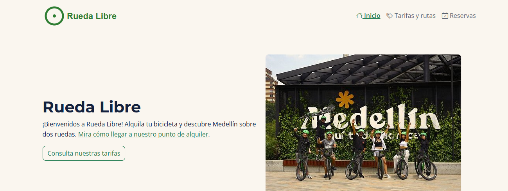

# Rueda Libre · Sitio web

Sitio multipágina y responsive para una tienda de bicicletas y rutas en Medellín, con la landing de campaña Rueda Nocturna.

**Sitio publicado:** https://yulianadurangoh.github.io/rueda-libre/

## Páginas
- `index.html`: inicio con la propuesta de valor.
- `paginas/tarifas.html`: tarifas de servicios.
- `paginas/reservas.html`: formulario de reservas.
- `nocturna/index.html`: landing de Rueda Nocturna con modo oscuro.
- `nocturna/componentes.html`: kit de componentes.

## Tecnologías
- HTML5 semántico
- Bootstrap 5.3 (sitio principal)
- Tailwind CSS 4 con CLI (landing Rueda Nocturna)

## Framework elegido y justificación
Bootstrap se usa en el sitio principal porque ya tiene sus componentes armados y el sitio se construyó con él desde el inicio. Tailwind se usa en la landing de Rueda Nocturna porque permite definir los colores y fuentes de la marca con `@theme` y hacer el modo oscuro con `dark:`, con un CSS final más liviano.

## Capturas

## Autor
Yuliana Durango · [GitHub](https://github.com/yulianadurangoh)